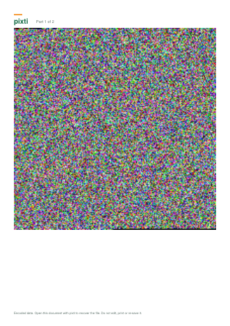

# pixti

**Turn any file into a lossless "image document" (a PDF made of pixel data), send it anywhere
as an ordinary attachment, and recover the exact original later.**
Everything runs in your browser. No account, no server, no uploads.

<p align="center"></p>

> **Why a PDF and not a PNG?** Chat and e-mail apps normally deliver documents unchanged but
> often recompress photos, which destroys hidden data. A PDF is treated as a document, and
> pixti stores the pixels in it *unfiltered*, so there is nothing lossy anywhere in the path.
> If something *does* alter a file in transit, pixti detects it (checksums, AES-GCM) and
> refuses to produce a wrong file.

## Features

* Any file type, treated as raw bytes. Exact bytes, name and MIME type are preserved.
* Optional password protection: AES-256-GCM, PBKDF2-SHA-256 (600 000 rounds), all via Web Crypto.
* Automatic DEFLATE compression, used only when it actually makes the data smaller.
* Large files become multi-page PDFs, or several PDFs (e.g. ≤ 10 / 20 MB for e-mail).
  Files can be uploaded in any order; missing, duplicate, damaged and mixed-up pages are named.
* Every result is verified: after encoding, the finished PDF is read back and compared
  byte-for-byte; after decoding, the file's SHA-256 must equal the stored original digest.
* Work runs in a Web Worker with real, stage-based progress and a cancel button
  (cancelling terminates the worker, which frees all memory).
* Responsive layout in the sunshine-green palette, built for keyboard and screen-reader use (labels, focus rings, live regions; not yet formally audited). Opt-in local history.

## Tech stack

React 18 · Vite · TypeScript (strict) · Tailwind CSS 3 · lucide-react · React Router ·
Web Workers · Web Crypto · native `CompressionStream` · Vitest · Playwright.
No backend, no API keys, no paid services.

## Getting started

```bash
npm install
npm run dev          # http://localhost:5173
```

| Command | What it does |
|---|---|
| `npm run dev` | Dev server |
| `npm run build` | Production build into `dist/` |
| `npm run preview` | Serve the production build locally |
| `npm run typecheck` | `tsc --noEmit` (strict) |
| `npm run lint` | ESLint |
| `npm test` | Vitest unit + round-trip tests (no browser needed) |
| `npm run test:e2e` | Playwright tests against the production build (`npx playwright install chromium` once; use a UTF-8 locale, e.g. `LC_ALL=C.UTF-8`) |
| `npm run bench` | Encode/decode timings for 1 KB – 50 MB |
| `npm run check` | typecheck + lint + test + build |

Web Crypto needs a secure context: use `localhost` or HTTPS (Vercel provides HTTPS).

## Deploy to Vercel (free)

1. Push this folder to a GitHub repository.
2. On vercel.com choose **Add New → Project**, import the repository. The Vite preset is
   detected; `vercel.json` already sets build command, output directory, SPA rewrites (so
   `/decode` works after a refresh) and a strict Content-Security-Policy.
3. Deploy. No environment variables or accounts for third-party services are needed.

## How it works

1. **Read & fingerprint** — the file's bytes and SHA-256 are taken.
2. **Compress** — zlib DEFLATE via `CompressionStream`, streamed so progress is real and the
   attempt is abandoned as soon as it can't win. Stored only if strictly smaller.
3. **Envelope** — file name, MIME, size, SHA-256 and the data go into one inner envelope.
4. **Encrypt (optional)** — the envelope is encrypted once with AES-256-GCM. A fresh random
   salt and nonce are used every time; the header fields (including the iteration count) are
   authenticated as additional data. Encrypted sets expose no file name, type or checksum.
5. **Split** — the payload is divided into balanced parts, each with a 120-byte header
   (session id, part index/count, lengths, part SHA-256, KDF parameters, header CRC).
6. **Pixels & PDF** — each part becomes one page: raw RGB, 3 bytes per pixel, near-square,
   zero padding. The PDF is verified by re-reading it with the same strict reader the decoder uses.

Decoding reverses this and only offers the file after the GCM tag *and* the final SHA-256
both pass. The complete byte-level specification is in [`docs/FORMAT.md`](docs/FORMAT.md).

## Limits and device limitations

* **Largest file: 64 MB** (design target ≈ 50 MB). Limits are centralised in
  `src/core/limits.ts` and enforced before any allocation.
* Peak memory while encoding is roughly 3–4× the file size (file, compressed copy,
  envelope/ciphertext, output PDF). On phones or old computers, lower **Data per page** in
  Advanced settings; if the browser still runs out of memory, pixti shows an explanatory
  error instead of freezing, and you can split the file first.
* Web Crypto's `digest`, PBKDF2 and AES-GCM are single calls with no progress callback, so those
  stages show an honest *indeterminate* bar rather than invented percentages.
* A pixti PDF must stay **unmodified**. Re-saving it, "printing to PDF", or running it
  through PDF optimisers breaks it (it will be reported as unreadable, never misdecoded).
* Output size ≈ input size (compressed data is high-entropy and PDF stores it unfiltered).
* Needs a current browser with module workers, `CompressionStream` and Web Crypto
  (recent Chrome/Edge/Firefox, Safari 16.4+). Only Chromium has been tested (see below).

## Security notes and limitations

* All processing is local. There is no telemetry and no third-party script; the CSP in
  `vercel.json` blocks outbound connections (`connect-src 'self'`).
* Passwords and keys are never stored, logged, or put in URLs; the Encode page clears its
  password fields as soon as the job finishes. History (opt-in) stores names, sizes and dates only.
* **Anyone holding an encrypted PDF can try passwords offline.** PBKDF2 slows that down but
  cannot rescue a weak password. The strength meter is a rough heuristic, not a guarantee.
  A lost password cannot be recovered.
* Encrypted sets still reveal: that it is a pixti set, the format version, KDF settings,
  approximate size, and the number of parts. Unencrypted sets reveal everything, including the file name.
* Encryption proves nothing about *who* made a file. The decode page cannot judge whether
  a recovered file is safe; only open files you trust.
* PBKDF2 was chosen for native browser support. The KDF is behind a registry
  (`src/core/encryption/keyDerivation.ts`) so Argon2id can be added later without breaking old sets.
* This code has not had an independent security audit.
* **pixti is not a substitute for proper, long-term backups.**

## Testing

```bash
npm test
```

Covers (in `tests/`): header serialisation/parsing and malicious-field rejection; inner envelope;
pixel mapping for sizes 1…3000; PDF writing/reading and rejection of truncated/edited PDFs;
compression and decompression-bomb limits; AES-GCM (wrong password, flipped ciphertext and tag
bits, AAD binding, unique salts/nonces, KDF bounds); splitting/merging and every set-analysis rule;
full round trips for TXT, PDF, PNG, JPEG, MP3, MP4, ZIP, EXE, empty, 1–4 byte and random files,
with and without encryption; shuffled/missing/duplicate/corrupt/mixed/forged parts; hostile
file names; progress stages; cancellation; and the worker protocol including crashes.

`npm run test:e2e` drives the real UI (encode → download PDF → decode → compare SHA-256,
wrong password, split sets with a missing file, non-pixti PDFs, deep links).

### Measured results

Measured during development in a **single-core sandbox VM** with **headless Chromium 141**,
encryption on (600 000 PBKDF2 rounds), incompressible random data unless noted. This is not a
low-power device; please run `npm run bench` and the app on your own hardware and add the numbers here.
"Longest main-thread gap" is the worst delay of a 20 ms timer on the page while the worker ran,
i.e. a direct measure of UI responsiveness.

| File | Pages | PDF size | Encode | Decode | Longest main-thread gap (encode) |
|---|---:|---:|---:|---:|---:|
| 1 KB | 1 | 1.8 KB | 213 ms | 202 ms | 25 ms |
| 10 MB | 2 | 10.00 MB | 1.12 s | 0.27 s | 23 ms |
| 25 MB | 4 | 25.02 MB | 1.15 s | 0.63 s | 25 ms |
| 50 MB | 7 | 50.03 MB | 2.34 s | 1.11 s | 21 ms |
| 50 MB of zeros (no encryption) | 1 | 0.05 MB | 0.44 s | 0.42 s | 24 ms |

Every row was recovered byte-identical and verified. **Not measured:** peak memory,
Firefox/Safari, phones, or throttled/low-end CPUs.

## Project structure

```
src/
  app/            App shell and routes
  components/     layout, ui primitives, upload (Dropzone), progress, preview, brand
  features/       home, encode (EncodePage + encodeService), decode (DecodePage + decodeService),
                  history, settings
  core/           UI-free, independently testable logic
    format/       header, inner envelope, validation, version constants, part parsing
    image/        pixel layout, PDF writer/reader, thumbnails
    compression/  DEFLATE via CompressionStream, bounded inflate
    encryption/   key derivation registry, AES-GCM encrypt/decrypt
    integrity/    SHA-256, CRC-32, final verification gate
    splitting/    split, merge, set analysis (missing/duplicate/corrupt/mixed)
  workers/        protocol, handler, job runner (cancel = terminate), worker entry
  hooks/ utils/ types/
tests/            Vitest suites          e2e/   Playwright tests
scripts/          benchmark              docs/  FORMAT.md
```

## Design decisions that differ from a "PNG per image" design

* **PDF output** (one PDF with many pages, or several PDFs) so the result survives chat/e-mail untouched.
* **Opaque RGB** pixels (3 bytes/pixel) instead of RGBA: viewers never blend or premultiply alpha,
  and the pages render as ordinary opaque images.
* **Native `CompressionStream`** instead of a bundled library: no dependency, streaming, and real progress.
* No decorative pixel layouts, ZIP export or dark theme in v1; the simplest reversible mapping is the default.

## License

MIT
